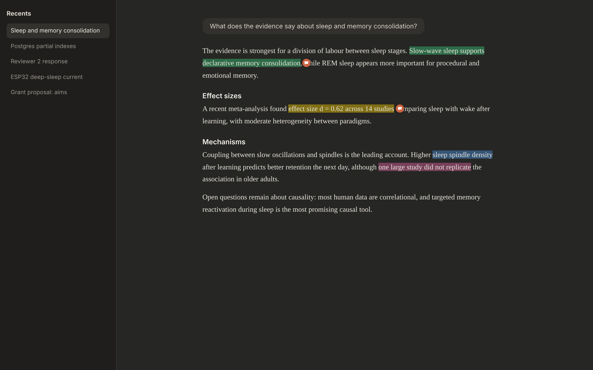
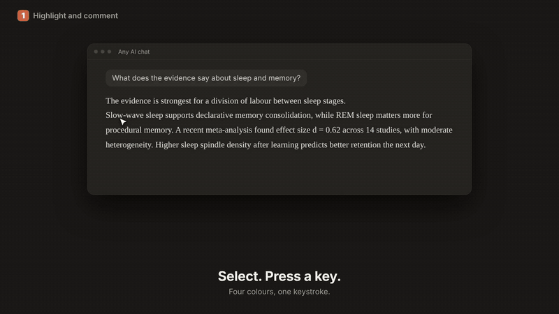
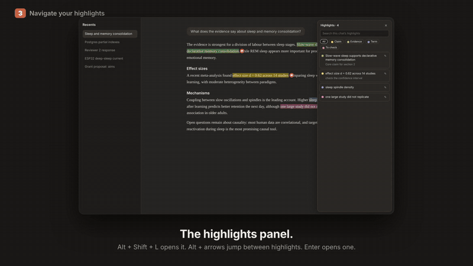
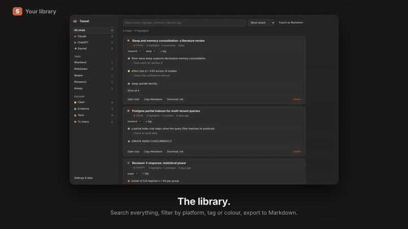
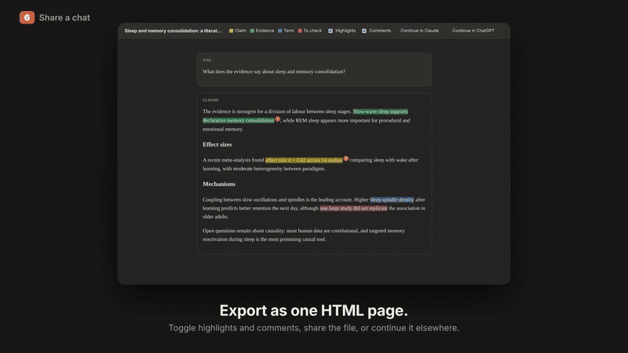

<div align="center">

# Tessel

**Turn your AI chats into a searchable, annotated knowledge base.**

Permanent highlights and comments for Claude and ChatGPT conversations. Keyboard-first, private by design, no account, no servers.

[Install](#install) · [Quick start](#quick-start-60-seconds) · [Features](#features) · [Docs](docs/USAGE.md) · [How it works](docs/ARCHITECTURE.md) · [Contributing](CONTRIBUTING.md)

[](https://github.com/onkar-borde/tessel/actions/workflows/test.yml) [](https://github.com/onkar-borde/tessel/releases/latest)     



</div>

> Independent open-source project. Not affiliated with or endorsed by Anthropic or OpenAI. "Claude" and "ChatGPT" are used only to say which sites it works on.

## See it in action

<!-- VIDEO: on github.com, edit this file and drag the intro video in here. GitHub turns it into an inline player. -->


https://github.com/user-attachments/assets/9e063722-7f78-481d-9c87-215019b1ce26

https://github.com/user-attachments/assets/88777f0e-7cb9-4302-aada-8811f82a5575


| Highlight and comment | Keyboard navigation |
| --- | --- |
|  |  |
| **Library** | **Share and continue** |
|  |  |

## Why

Your AI conversations are becoming a second brain. A single long research answer can hold the one claim, number or snippet you will need next month, and then it scrolls away inside a chat you will never find again. Tessel keeps the useful parts:

1. **Mark** what matters while you read: select text, press a key.
2. **Annotate** it with a comment, a colour with a meaning you chose, tags and stars.
3. **Find** it again: one searchable library across every chat, Claude and ChatGPT together.
4. **Take it with you**: share a chat with the highlights, continue it on the other platform, back it up.

It is built for people who use these tools for real work (researchers, developers, analysts, writers) and live on the keyboard.

## Features

| | |
| --- | --- |
| **Highlight with one key** | Select text, press `1`-`4` (four colours) or `H` (last colour). A small toolbar appears next to the selection if you prefer the mouse. |
| **Comments** | `C` highlights and opens a comment box. Click any highlight later to edit, recolour, copy or delete it. A badge marks highlights that carry a comment. |
| **Colours with meaning** | Rename the four colours (Claim, Evidence, Term, To check), or add up to four custom ones of your own (keys `5`-`8`). Names show in tooltips, filters, exports and Markdown. |
| **Keyboard navigation** | `Alt`+`↓`/`↑` step through the highlights in a chat, `Alt`+`Shift`+`L` opens a panel listing them in reading order, like a table of contents for a long answer. |
| **Library** | Every chat in one place: platform, starred, tags, colour filter, full-text search across highlights, comments, titles and tags. Export a chat or the whole view as Markdown. |
| **Share a chat** | One self-contained HTML file with the conversation, your highlights and your comments. Readers get switches to hide either. No scripts from the site, no tracking. |
| **Continue anywhere** | "Continue in Claude" / "Continue in ChatGPT" copies the conversation as a clean prompt and opens a new chat on the other platform. Move a chat between platforms in two clicks. |
| **Data safety** | Stored locally, mirrored to a safety copy, and optionally backed up to files in your Downloads folder that survive reinstalls. One-click restore. |
| **Private** | No account, no analytics, no network requests. Everything stays in your browser. |

<table>
<tr>
<td width="50%"><br><sub>Select text, press a key. The toolbar is optional.</sub></td>
<td width="50%"><br><sub>Comments live with the highlight.</sub></td>
</tr>
<tr>
<td><br><sub>The panel lists a chat's highlights in reading order.</sub></td>
<td><br><sub>The Library: every chat, searchable.</sub></td>
</tr>
</table>

## Install

> Store listings are coming. Until then, grab a zip from the [latest release](https://github.com/onkar-borde/tessel/releases/latest) or build from source (two minutes).

**Chrome, Edge, Brave, Opera, Vivaldi, Arc** (Chromium 105+)
1. Download `tessel-chromium-*.zip` from the [latest release](https://github.com/onkar-borde/tessel/releases/latest) and unzip it, or clone this repo and run `npm install && npm run build`.
2. Open `chrome://extensions`, turn on **Developer mode**, click **Load unpacked**, select the unzipped folder (or `dist/chromium`).
3. Reload any open claude.ai / chatgpt.com tabs.

**Firefox 140+**
1. `npm install && npm run build`.
2. Open `about:debugging#/runtime/this-firefox` → **Load Temporary Add-on** → pick `dist/firefox/manifest.json`. A temporary add-on is removed when Firefox restarts, together with its data; a permanent install needs the signed store version.
3. Reload claude.ai / chatgpt.com.

**Safari 17.2+** can be built with `xcrun safari-web-extension-converter dist/chromium`. Untested.

## Quick start (60 seconds)

1. Open a chat on claude.ai and select a sentence in an answer.
2. Press `1` (yellow). It stays highlighted, permanently.
3. Select another passage and press `C`. Type a note, press `Ctrl`/`⌘`+`Enter`.
4. Press `Alt`+`↓` to jump between your highlights, or `Alt`+`Shift`+`L` for the panel.
5. Click the toolbar icon for the popup, then **Library** to search every chat you have annotated.
6. In the popup choose **Export HTML** to share the chat with your highlights.

More detail, with a screenshot for every feature: **[docs/USAGE.md](docs/USAGE.md)**.

## Keyboard shortcuts

| Keys | Does | When |
| --- | --- | --- |
| `1` `2` `3` `4` | Highlight yellow / green / blue / pink | Text in the conversation is selected |
| `H` | Highlight in the last colour you used | Text selected |
| `C` | Highlight and open the comment box | Text selected |
| `Alt`+`↓` / `Alt`+`↑` | Next / previous highlight | Anywhere outside a text box |
| `Enter` | Open the highlight you just jumped to | Right after `Alt`+`↓`/`↑` |
| `Ctrl/⌘`+`Enter` | Finish a comment | In the comment box |
| `Esc` | Close the toolbar or comment box | |
| `Alt`+`Shift`+`L` | Show / hide the highlights panel | Anywhere outside a text box |
| `Alt`+`Shift`+`H` / `C` | Same as `H` / `C` | Anywhere; remap on your browser's shortcuts page |

On Mac, `Alt` is `Option`. Single-key shortcuts never fire while you type in a text box (including the prompt box) or with `Ctrl`, `⌘`, `Alt` or `Shift` held, so they cannot collide with the browser or the site. Turn **Quick keys** off in the popup's settings if one ever does.

## Supported sites and browsers

| Site | Status | Notes |
| --- | --- | --- |
| claude.ai | **Stable** | Tested by the author in Chrome and Firefox. |
| chatgpt.com | **Beta** | Works in the tested layouts, but on some signed-in ChatGPT pages the highlight toolbar does not appear. See [Known issues](#known-issues). |

| Browser | Status |
| --- | --- |
| Chrome, Edge, Brave, Opera, Vivaldi, Arc (105+) | Supported. Automated tests run in real Chromium. |
| Firefox 140+ | Supported. Used on claude.ai; passes `web-ext lint`. |
| Safari 17.2+ | Buildable, untested. |
| Phones and tablets | Not a target. |

The operating system does not matter. Highlights are drawn with the CSS Custom Highlight API (Chrome/Edge 105, Safari 17.2, Firefox 140).

## Privacy

- Nothing leaves your device. No servers, accounts, analytics or telemetry; the extension makes no network requests.
- Permissions are the minimum needed: `storage` and `unlimitedStorage` (your highlights), `contextMenus` (right-click menu), `alarms` (schedule the optional backup), and access to claude.ai and chatgpt.com only. `downloads` is **optional** and requested only if you turn on automatic backups.
- The full policy is in [PRIVACY.md](PRIVACY.md).

## Your data

Highlights live in the browser's extension storage on your device. They survive restarts and updates, and clearing history or cookies does not remove them. They are deleted if you uninstall the extension or remove the browser profile, and they do not sync between browsers or devices. To make that safe:

1. **Safety copy.** Every edit and deletion is mirrored into a second copy. If every chat record vanishes while the copy still has them, they are restored at startup. Highlights you delete are deleted from the copy too.
2. **Automatic backup files (opt-in).** Library → Settings → *Back up automatically to my Downloads folder*. A `latest` file and one file per weekday are kept in `Downloads/Tessel backups/`, outside the browser, so they survive uninstalling, reinstalling and moving computers.
3. **One-click restore.** An empty Library offers *Restore from backup*. Restore merges and never overwrites, and reads every earlier backup format.

Details: [docs/STORAGE.md](docs/STORAGE.md).

## Sharing and moving chats

- **Export HTML** creates one file with the conversation, highlights and comments. Open it and read it before you send it: it contains the whole conversation.
- **Continue in Claude / ChatGPT** (in the export and in the popup) copies the conversation as a plain prompt and opens the other platform's new-chat page with as much of it as fits in the address. The clipboard holds all of it. The prompt never mentions highlights.
- **Share link (optional).** Create a link with the site's own Share button, paste it into the popup, and exports gain an "Open the chat" button. What the link allows is up to the site: Claude's invite-only links open only for the invited email and are view-only. Tessel never creates links and never contacts the sites' servers.

## How it works

Highlights are painted with the CSS Custom Highlight API, so the extension never edits the site's DOM and stays safe with re-renders and streaming answers. Each highlight is stored as a text quote plus about 40 characters of context on each side; when the page changes the quote is found again, and repeated phrases are told apart by their context. Everything site-specific lives in one profile per site (`lib/sites.js`). Architecture, the anchoring algorithm and the message flow: **[docs/ARCHITECTURE.md](docs/ARCHITECTURE.md)**.

## Known issues

- **ChatGPT, signed in: the toolbar may not appear.** In one signed-in layout the extension found no messages and rejected a selection as "outside the conversation area". The cause is not understood yet because the author could not inspect a signed-in session. Run **popup → ⚙ → Diagnostics** on an affected page and paste the output in an issue (the report contains tag names and attribute names, never your messages). This is the most useful contribution you can make right now.
- Chats are identified by their address (`claude.ai/chat/<id>`, `chatgpt.com/c/<id>`). A brand-new chat can be highlighted at once; those highlights are held in memory until the site names the chat, so reloading before that loses them. ChatGPT temporary chats and shared-link pages are not covered.
- The Claude desktop app's chat tab is not supported (it is not a browser). Use the website.
- Highlights belong to one browser profile; use backups to move them. There is no cross-device sync.
- If the text of an old message changes, highlights on the removed text cannot be found; they stay saved and are flagged "Not found in the page right now".
- Export labels ("You", "Claude", "ChatGPT") depend on each site's markup. If a site changes it, export still works but may lose labels. Fixing a profile in `lib/sites.js` is a small PR.

## Development

```bash
npm install
npm test                  # unit + simulated-browser tests (node:test, jsdom)
npm run build             # dist/chromium and dist/firefox, each with a zip
npm run lint:firefox
CHROME_PATH=/path/to/chrome npm run test:e2e   # real-browser end-to-end tests
node scripts/media/shots.mjs                   # regenerate docs/img from the real UI
```

Project layout, how the pieces talk to each other and how to add a site are in [docs/ARCHITECTURE.md](docs/ARCHITECTURE.md) and [CONTRIBUTING.md](CONTRIBUTING.md). For Firefox releases set `GECKO_ID=you@yourdomain` once and keep it forever: the id is what ties stored data to the extension across updates.

## Roadmap

- [ ] ChatGPT signed-in layout (needs diagnostics from users)
- [ ] Store releases (Chrome Web Store, Firefox Add-ons, Edge)
- [ ] Highlights visible on a forked chat on the other platform
- [ ] More sites, each as a small profile (see CONTRIBUTING)

Ideas and votes are welcome in [Discussions](../../discussions).

## Contributing

Bug reports with a Diagnostics paste, new site profiles and tests are the most valuable contributions. See [CONTRIBUTING.md](CONTRIBUTING.md). Security issues: [SECURITY.md](SECURITY.md).

## Support the project

If Tessel saves you time, a ⭐ on the repo helps other people find it. Follow [@onkar-borde](https://github.com/onkar-borde) for what comes next.

## License

[MIT](LICENSE) © Onkar Borde
