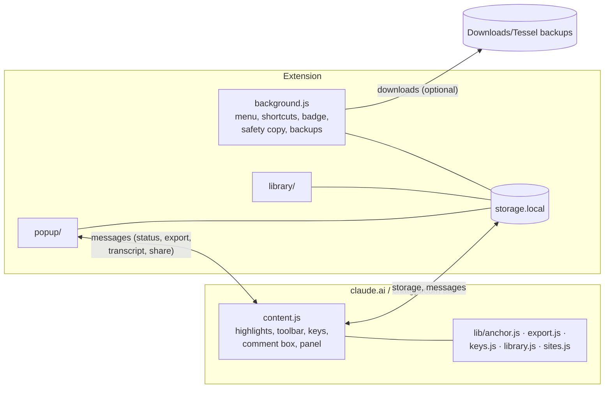

# Architecture

Tessel is plain JavaScript (no framework, no bundler, no runtime dependencies). The repository root is the Chromium MV3 build; `scripts/build.mjs` produces the Firefox package from the same files (only the manifest differs).

## Pieces

| File | Role |
| --- | --- |
| `lib/sites.js` | One **profile** per site: hostnames, how to read the chat id from the URL (and optionally from the page), conversation container, role selectors, new-chat URL, storage key prefix. Everything site-specific is here. Pure data and functions. |
| `lib/anchor.js` | Text-quote anchoring. Builds a flat text index of a container, finds a quote again after the page changes, converts offsets to DOM ranges. Pure DOM logic, unit-tested with jsdom. |
| `content.js` | Runs on supported sites. Loads the chat's record, paints highlights with the CSS Custom Highlight API, shows the toolbar and comment popover (in a shadow root so the page's CSS cannot touch it), handles keys, watches the page for changes and route changes, answers messages from the popup. |
| `lib/keys.js` | Pure rules for which key does what and when (never while typing, never with modifiers). |
| `lib/export.js` | Builds the shareable HTML: clones the conversation, applies highlights to the clone, sanitises it (allow-list of attributes, no scripts), adds toggles, the continue buttons and the transcript. |
| `lib/library.js` | Pure functions over the stored data: listing, filters, tags, Markdown, backup build and merge. Shared by popup and Library. |
| `lib/durability.js` | Pure helpers for the safety copy and backup file names. |
| `background.js` | Context menu, command shortcuts, toolbar badge, the safety-copy mirror, the optional automatic backup (alarms + downloads). |
| `popup/`, `library/` | The extension's own pages, built from `lib/ui.js`. |

## Highlights: how they stay put

The extension never changes the site's DOM, because the sites are React apps that re-render and stream.

1. When you highlight, the selection is turned into an **anchor**: the exact text plus up to 40 characters of prefix and suffix, taken from a flat text index of the conversation container.
2. When the page changes (debounced mutation observer) the anchors are located again. A candidate is every occurrence of the exact text; the one whose surroundings best match the stored prefix and suffix wins. Repeated phrases are told apart this way.
3. Located ranges are given to `CSS.highlights` under `hfc-yellow`, `hfc-green`, ... and styled by `::highlight(...)` in `content.css`.
4. Highlights whose text cannot be found stay saved and are marked "Not found in the page right now".

## Which chat is this?

A chat's id comes from the page's own markup if the profile provides a reader for it, otherwise from the URL. The URL is checked on history events, on focus, on mutations and every half second, because single-page apps change it without reloading and sometimes late. A chat with no id yet (a brand-new one) keeps highlights in memory and files them under the chat when an id appears.

## Messaging

Popup to content script: `hfc:status`, `hfc:create`, `hfc:jump`, `hfc:export`, `hfc:transcript`, `hfc:share`, `hfc:panel`. Content script to background: `hfc:count` (badge). Library to background: `hfc:backup-now`.

## Safety

- The in-page UI is a closed shadow root; nothing from the page can read it.
- Exports are rebuilt from a sanitised clone with an allow-list of attributes; links are limited to `http(s)`/`mailto`/`#`, images to `http(s)` and common `data:` image types.
- Pasted share links are accepted only for supported hosts over https, with no credentials or ports.
- No network requests anywhere.

## Adding a site

1. Add a profile to `lib/sites.js`.
2. List the host in `manifest.json` (`host_permissions` and `content_scripts[0].matches`). A unit test fails if the manifest and the profiles disagree.
3. Add a mock page to `test/e2e/smoke.mjs` and run the end-to-end tests.

## Tests

| Command | What it covers |
| --- | --- |
| `npm test` | Anchoring, export (including hostile input), keys, site profiles, library, backup and safety copy, and the background script run against a simulated extension API. |
| `npm run test:e2e` | A real Chromium with real mouse and keyboard on mock chat pages (each site profile, plus an unsupported host where it must stay inert), and the popup and Library pages. |
