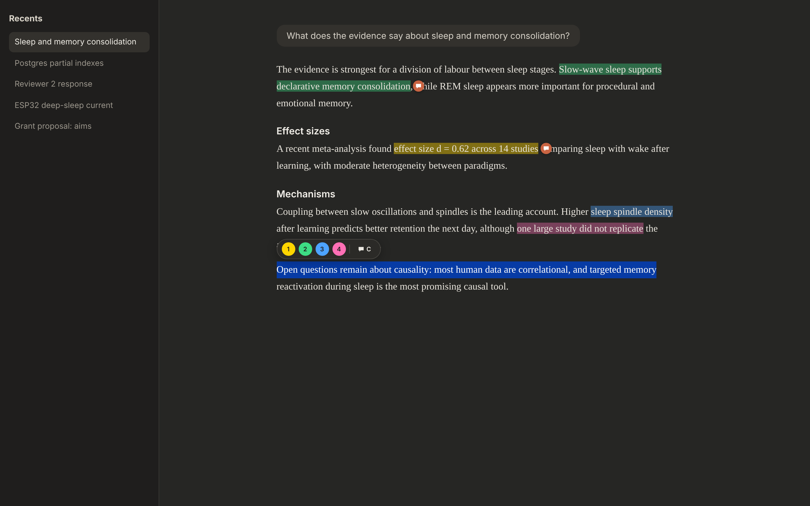
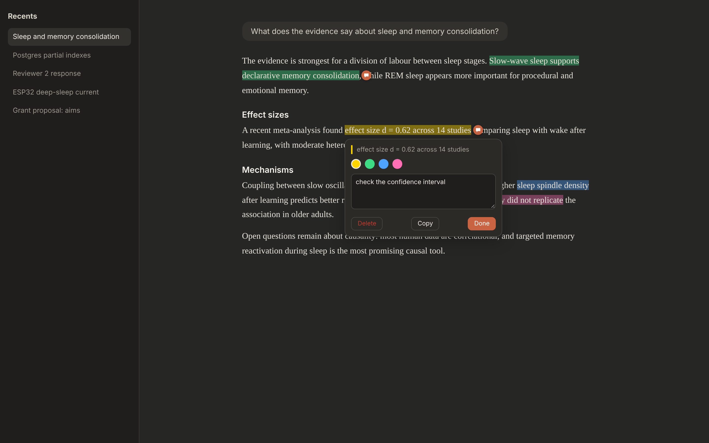
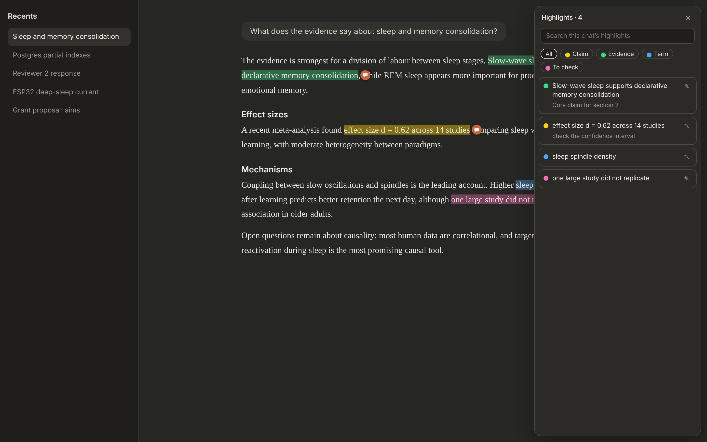
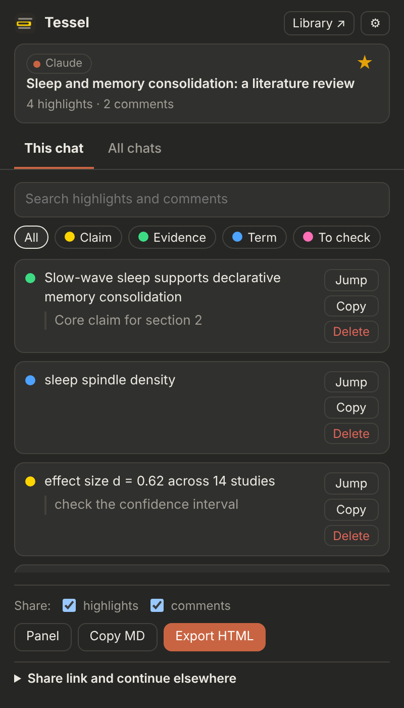
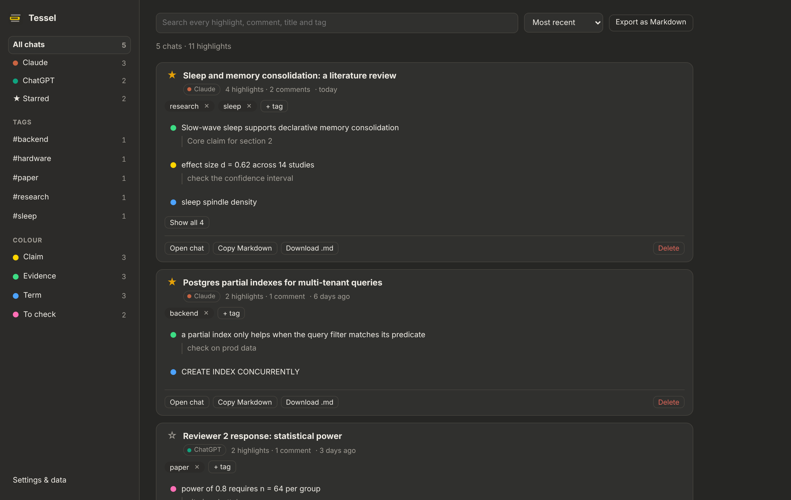
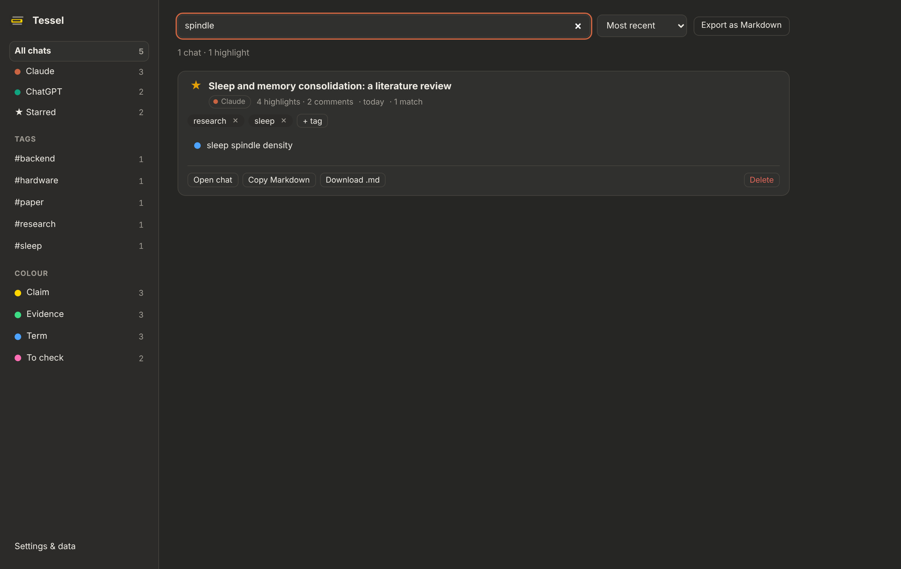
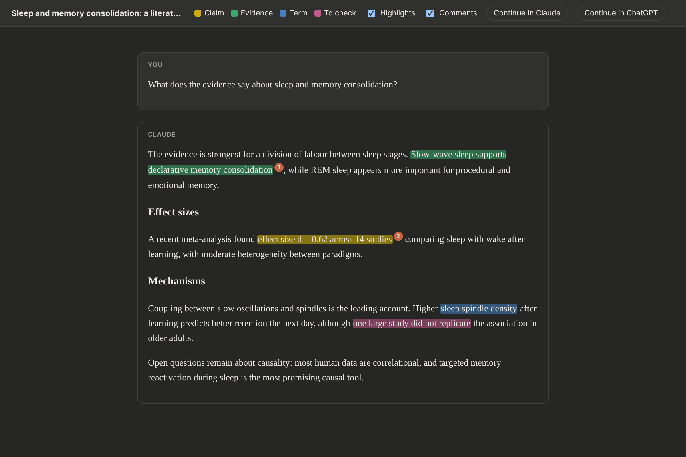
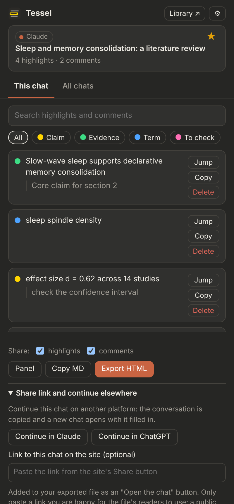
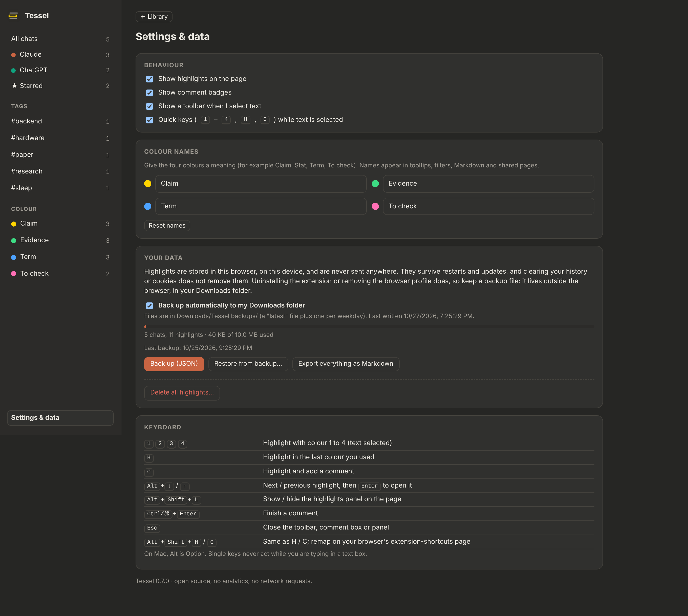

# Using Tessel

A walkthrough of every feature. Each section has a short video in [docs/media](media) (see the list at the end).

## 1. Highlight

Select text in an answer. A small toolbar appears next to the selection with the four colours; or just press a key:

| Key | Result |
| --- | --- |
| `1` `2` `3` `4` | Yellow, green, blue, pink |
| `H` | The colour you used last |
| `C` | Highlight and open the comment box |

Highlights are saved per chat, immediately. Reload, close the browser, come back in a month: they are painted again on the same text. The prompt box and other editable fields are never highlighted. Right-click works too (menu: *Tessel → Highlight*).

If the toolbar gets in the way, turn it off in the popup's settings; the keys keep working.

## 2. Comment

Press `C` on a selection, or click an existing highlight. Type a note; it saves as you type. `Ctrl`/`⌘`+`Enter` finishes. In the same box you can change the colour, copy the highlight as a Markdown quote (with a link back to the chat), or delete it (Undo appears for a few seconds).

Highlights with a comment get a small badge at the end of the text.

## 3. Move around a long answer

- `Alt`+`↓` / `Alt`+`↑` jump to the next / previous highlight in the chat; `Enter` opens it.
- `Alt`+`Shift`+`L` shows the **panel**: this chat's highlights in reading order, with search and colour filters. Click one to jump to it.

## 4. Name your colours

Library → Settings → *Colour names*. Call them Claim, Evidence, Term, To check, or whatever your work needs. The names appear in tooltips, the panel, filters, Markdown and shared pages. Colours are only labels; the keys stay `1`-`4`.

## 5. The popup

Click the toolbar icon. **This chat** lists the highlights (search, colour chips, Jump, Copy, Delete), and the buttons at the bottom share it. **All chats** lists every chat you have annotated, split by platform. Star a chat with the star in the top card.

## 6. The Library

Popup → *Library* (or the extension's options page). Everything in one place:

- Platforms (Claude, ChatGPT), **Starred**, and your **tags** in the sidebar.
- Search across highlights, comments, chat titles and tags.
- Filter by colour, sort by recent, number of highlights or title.
- Per chat: open it, copy it as Markdown, download it as `.md`, add tags, delete it (two clicks).
- *Export as Markdown* for the whole current view.

Search finds text inside highlights and comments:

## 7. Share a chat

Popup → **Export HTML**. Choose whether to include highlights and comments, and optionally filter to one colour first. You get one self-contained file; readers can open it in any browser and switch highlights and comments on or off. Highlights that cannot be found on the page at export time are skipped, and you are told how many.

Read the file before you send it: it contains the whole conversation.

## 8. Continue a chat somewhere else

In the popup, open *Share link and continue elsewhere*, or use the buttons in an exported file:

- **Continue in Claude / ChatGPT** copies the conversation as a plain prompt and opens a new chat on that platform with as much of it as fits in the address (the clipboard has all of it; if the new chat is empty, paste). The prompt contains the conversation and your written notes, and no mention of highlights.
- **Share link (optional)**: paste a link made with the site's own Share button. Exports then include an "Open the chat" button. What the link allows is up to the site (Claude's invite-only links are view-only and bound to the invited email).

## 9. Backups and moving to a new computer

Library → Settings → *Your data*.

- **Back up automatically to my Downloads folder**: turn it on once (the browser asks for permission to save files). Tessel then keeps `Tessel backups/highlights-backup-latest.json` and one file per weekday up to date.
- **Back up (JSON)** makes a file on demand; **Restore from backup** merges one in (never overwrites).
- On a new computer or after a reinstall, an empty Library shows a banner with **Restore from backup**.

## 10. Diagnostics

Popup → ⚙ → *Diagnostics* shows what the extension sees on the page (site, chat id, whether messages were found, why a selection was ignored). It contains tag and attribute names only, never message text. Copy it into bug reports.

## Videos

| Topic | File |
| --- | --- |
| Overview | [Intro video](../README.md#see-it-in-action) |
| Walkthrough of every feature | [Watch the walkthrough](https://github.com/user-attachments/assets/88777f0e-7cb9-4302-aada-8811f82a5575) |
| Highlight and comment | `media/highlight-comment.gif` |
| Keyboard navigation and panel | `media/keyboard.gif` |
| Library | `media/library.gif` |
| Share and continue | `media/share.gif` |
| Backups | `media/backup.gif` |
